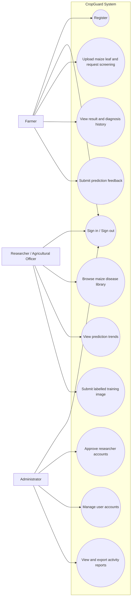
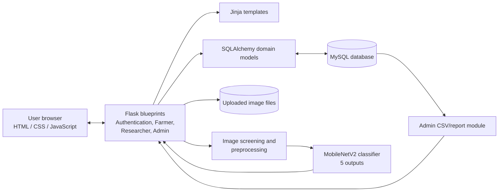
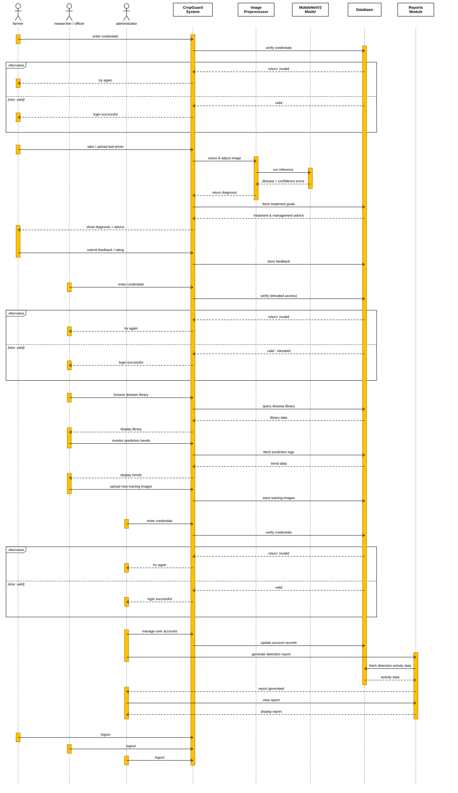
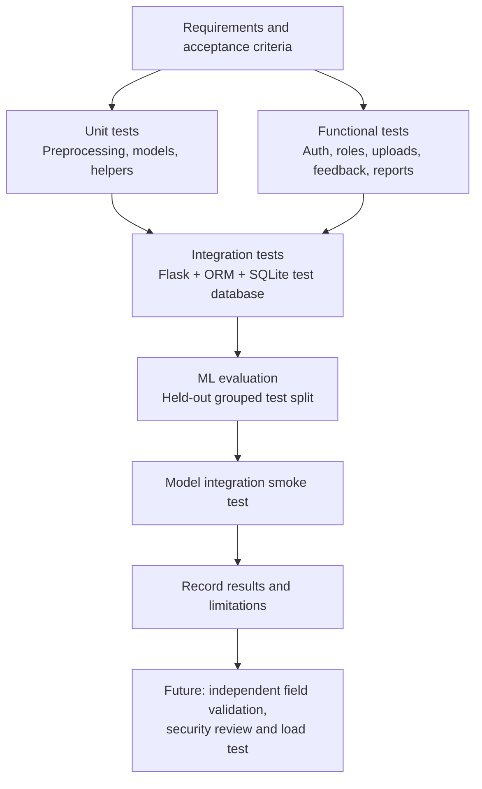

# Chapter 4: System Analysis and Design

## 4.1 Introduction

This chapter presents the analysis and design of CropGuard, a web-based
maize-leaf disease screening system. It states the system's functional and
non-functional requirements, identifies the principal users and their
interactions, and describes the software architecture, diagnosis workflow,
and logical database schema. The analysis and design are expressed using a
role-oriented use-case view, an application architecture view, a sequence
diagram, and an entity-relationship view of the database.

The implementation follows a Model–View–Controller (MVC) organization:
SQLAlchemy models represent persisted data, Flask blueprints implement
request-handling controllers, and Jinja templates render pages. Object
oriented analysis and design (OOAD) ideas are used for domain entities such
as users, disease classes, diagnoses, and feedback. The system is not a
strict implementation of a single UML process; its workflow diagrams also
show the ordered image-processing steps. This distinction helps keep the
design faithful to the actual Flask application.

CropGuard accepts maize-leaf photographs and screens them as Healthy,
Maize Leaf Blight (the PlantVillage Northern Leaf Blight label), Maize Common
Rust, or Maize Gray Leaf Spot. A fifth model output, `Reject`, is used for
unsupported or non-maize benchmark images and is not a disease-library
entry. The output is a screening aid, not a confirmed agronomic diagnosis.

## 4.2 System Requirements

System requirements describe what CropGuard must do and the conditions
under which it should operate. Requirements below distinguish implemented
behaviour from performance or deployment targets that have not yet been
verified.

### 4.2.1 Functional Requirements

The system's principal functional requirements are:

i. **Registration and account creation.** A visitor can submit a name,
username, email address, role, and password through the registration form.
Usernames and email addresses are unique. Researcher/officer accounts are
created pending administrative approval; farmer accounts can be used after
registration.

ii. **Authentication.** A registered user can log in with a username and
password and log out. The submitted password is checked against a bcrypt
password hash; the plaintext password is not stored. Invalid credentials,
inactive accounts, and unapproved researchers are denied access with a
message.

iii. **Role-based access.** The system separates Farmer, Researcher, and
Administrator routes. Researchers require administrator approval before
using elevated pages. Users cannot view another farmer's diagnosis result
through the result endpoint.

iv. **Maize-leaf upload.** A signed-in farmer can submit a leaf image using
an HTTP multipart form. The application allows PNG, JPG, and JPEG filename
extensions and limits request size to 8 MB by default. It generates a
unique server-side filename and performs a foliage/leaf-photo screening
check before invoking the classifier.

v. **Image preprocessing and screening.** An accepted image is converted to
RGB, contrast-adjusted using CLAHE on luminance, resized to 224 × 224 pixels,
scaled to the model's input range of approximately [-1, 1], and given a batch
dimension. The model predicts one of four maize classes or `Reject`.
Predictions outside the maize disease library, including `Reject`, are
refused rather than saved as a maize diagnosis.

vi. **Diagnosis result and history.** A successful diagnosis stores the
user, image reference, predicted disease class, confidence score, time, and
inference latency. Farmers can view their own results and recent diagnosis
history.

vii. **Treatment and prevention information.** The result page can present
the management and prevention guidance associated with a maize disease
class. The guidance is informational and advises consultation with local
agricultural experts; it is not an automated chemical prescription.

viii. **Farmer feedback.** A farmer can provide a one-time 1–5 star rating
and optional comment for their own prediction. Low ratings are marked for
review. Feedback is stored for reporting and future evaluation; it does not
automatically retrain or change the deployed model.

ix. **Researcher library and trends.** An approved researcher can browse
maize disease classes, view aggregated prediction trends, and submit
labelled images as training-image records with an initial pending status.
Those uploads are not automatically incorporated into model training.

x. **Administrator functions.** An administrator can review user accounts,
approve researchers, activate or deactivate other accounts, view usage
summaries, and export a detection-activity report as CSV.

xi. **Database initialization and migration.** The application provides
commands for creating its database tables, inserting demo data, and
synchronizing an existing disease library to the maize scope. The migration
preserves non-maize classes that have linked historical records; it is not
run automatically against a live database.

xii. **Progressive web application support.** The web interface exposes a
manifest and service worker so that a compatible browser can install the
application shell. Sign-in, uploads, diagnoses, dashboards, and saved
records still require a network connection.

### 4.2.2 Non-Functional Requirements

Non-functional requirements concern quality attributes, operational
constraints, and the protection of information.

i. **Security of credentials.** Passwords are hashed with bcrypt by
Flask-Bcrypt. Authentication state is managed by Flask-Login, and route
decorators check both authentication and role. A production deployment must
replace the development fallback secret key with a randomly generated
secret kept outside source control.

ii. **Transport security.** The local development server uses HTTP. The
application code does not itself configure a public TLS certificate or
enforce HTTPS. A production deployment must terminate HTTPS at a correctly
configured web server or reverse proxy and use secure session-cookie
settings. The project does not implement end-to-end encryption of uploaded
images.

iii. **Upload safety and data privacy.** The application restricts allowed
filename extensions, request size, generates unique filenames, and screens
for a leaf-like image before inference. These checks reduce accidental
misuse but do not constitute full malware scanning or proof of file content.
The current upload directory is under the application's static files;
production deployments handling private farm images should move uploads
outside the public static directory, restrict access, set a retention
policy, and consider encryption at rest.

iv. **Authorization and data integrity.** Farmer results are checked
against the authenticated owner's user ID. Foreign keys, unique constraints,
and non-null constraints enforce the principal relationships in the
database. Administrative and researcher capabilities are separated from
farmer capabilities.

v. **Usability.** The system provides browser-based pages for registration,
upload, diagnosis results, history, research functions, and administrative
reports. The PWA shell supports installation in compatible browsers, but
core transactions are not available offline.

vi. **Inference performance.** The model input is 224 × 224 RGB pixels.
One development smoke test on the recorded CPU environment completed
inference in approximately 2.7 seconds. This is a single sample and is not
a throughput or service-level benchmark. The project has not demonstrated
a three-second page-load guarantee or concurrent use by 5,000 users.

vii. **Scalability and availability.** The implementation is a single Flask
application using a relational database and local file storage. No
distributed deployment, horizontal scaling, high-availability design, or
large-scale load test has been demonstrated. Requirements such as 20
million users are outside the verified capacity of the current
implementation and would require architectural and infrastructure changes.

viii. **Model quality and limitations.** Evaluation is reported with
accuracy, macro precision, macro recall, macro F1, per-class results, and a
confusion matrix. The model was evaluated on a held-out PlantVillage
benchmark split, not on independent local farm photographs. Disease-level
recall differences are material and must be considered before practical
use.

ix. **Maintainability and reproducibility.** Dependency versions, dataset
revision, random seed, training settings, and model metrics are recorded in
the training workflow/report. The application separates routes, models,
preprocessing, and inference into modules. Re-running the same pipeline
still depends on access to the pinned source and compatible runtime
dependencies.

x. **Compatibility.** The recorded development environment is 64-bit
Windows 11 with Python 3.12.10 and TensorFlow 2.16.1 running on CPU. The
project uses Flask, SQLAlchemy, MySQL through PyMySQL, Pillow, OpenCV, and
browser-side HTML, CSS, JavaScript, and Bootstrap. A production MySQL
server and browser-specific compatibility matrix have not been measured.

## 4.3 System Analysis Diagrams

### 4.3.1 Use Case Diagram

The use-case view identifies the three principal actors and the services
available to each. A farmer registers or signs in, submits a maize leaf
image, views a diagnosis and history, and provides feedback. An approved
researcher explores the maize library and trends and submits labelled
training images. An administrator manages accounts, approves researchers,
and reviews or exports reports.

**Figure 4.1. CropGuard role-based use-case diagram.**



### 4.3.2 System Boundary and External Actors

The farmer or researcher uses a web browser to transfer an image and
interact with the Flask application. The application uses the configured
relational database and model artifact. During model development, the
training workflow also obtains selected images from the pinned PlantVillage
source. There are no IoT sensors, embedded boards, SMS gateways, or email
services in the implemented system.

## 4.4 System Design Diagrams

### 4.4.1 Application Architecture

The design follows MVC within a Flask application factory. The browser
renders Jinja templates returned by the routes. SQLAlchemy accesses the
MySQL database in the deployed configuration. The ML inference module
lazily loads the model and class mapping. Uploaded files are stored under
the configured upload directory. A deterministic demo predictor exists for
development when no trained model is available; it must not be interpreted
as a disease classifier.

**Figure 4.2. CropGuard high-level application architecture.**



### 4.4.2 Diagnosis Sequence

The farmer diagnosis path is an ordered request-response workflow: the
farmer authenticates, uploads a file, and the server applies file checks,
leaf screening, preprocessing, model inference, and a database-class
validation. An unsupported or non-maize result is rejected. A valid maize
result is stored and shown with its associated guidance. The repository
also contains a detailed sequence-diagram drawing.

**Figure 4.3. Farmer diagnosis sequence diagram.**



The sequence diagram source is maintained as
[`sequence_diagram.drawio`](./diagrams/sequence_diagram.drawio). It
illustrates interactions between the user roles, CropGuard, the
preprocessor, the MobileNetV2 model, the database, and reporting functions.

### 4.4.3 Logical Database Schema

The logical schema contains six main entities. A user may create many
predictions, feedback entries, and training-image submissions. A disease
class can have one treatment guide and many predictions and contributed
training images. Each feedback entry belongs to one prediction and one
user. Each training-image record is associated with a disease class and
the researcher who uploaded it. `prediction_records.disease_class_id` is
nullable to permit historical records to remain when a class is removed;
new accepted maize predictions must resolve to a maize disease class.

**Figure 4.4. Logical entity-relationship diagram.**

```mermaid
erDiagram
    USERS {
        int id PK
        string full_name
        string username UK
        string email UK
        string password_hash
        string role
        boolean is_approved
        boolean is_active_account
        datetime created_at
        datetime last_login_at
    }
    DISEASE_CLASSES {
        int id PK
        string name UK
        string crop_type
        string description
        string sample_image_path
        int model_output_index UK
    }
    TREATMENT_GUIDES {
        int id PK
        int disease_class_id FK_UK
        string treatment_text
        string management_tips
        string prevention_tips
        datetime updated_at
    }
    PREDICTION_RECORDS {
        int id PK
        int user_id FK
        int disease_class_id FK_NULL
        string image_path
        float confidence_score
        datetime predicted_at
        int inference_ms
    }
    FEEDBACK {
        int id PK
        int prediction_id FK_UK
        int user_id FK
        int rating
        boolean is_flagged_incorrect
        string comment
        datetime created_at
    }
    TRAINING_IMAGES {
        int id PK
        int disease_class_id FK
        int uploaded_by_id FK
        string image_path
        string status
        datetime uploaded_at
    }

    USERS ||--o{ PREDICTION_RECORDS : creates
    DISEASE_CLASSES o|--o{ PREDICTION_RECORDS : classifies
    DISEASE_CLASSES ||--o| TREATMENT_GUIDES : has
    PREDICTION_RECORDS ||--o| FEEDBACK : receives
    USERS ||--o{ FEEDBACK : submits
    DISEASE_CLASSES ||--o{ TRAINING_IMAGES : labels
    USERS ||--o{ TRAINING_IMAGES : uploads
```

The database schema is implemented in SQLAlchemy models and can also be
reviewed in [`database/schema.sql`](../database/schema.sql). Primary keys
identify records; unique constraints are applied to username, email,
disease-class name, model output index, treatment-guide disease class, and
prediction feedback. In the deployed configuration the database engine is
MySQL. Automated application tests use an in-memory SQLite database; a
live production database migration was not part of the recorded tests.

## 4.5 Chapter Summary

This chapter specified the system's role-based functional requirements and
quality requirements, described the MVC/OOAD approach, and presented the
use-case, architecture, sequence, and database diagrams. It also
distinguished implemented safeguards from non-functional targets that
require production configuration or further measurement.

# Chapter 5: System Implementation and Testing

## 5.1 Introduction

This chapter describes the environment and software used to implement
CropGuard, the PlantVillage dataset and its preparation, model training and
evaluation, application integration, and the testing approach. It reports
the measured benchmark metrics and automated test results while identifying
limitations such as the absence of field-photo validation, 10-fold
cross-validation, live-MySQL migration testing, and production load testing.

## 5.2 Description of the Implementation Environment

CropGuard was developed and tested as a local web application. A browser
communicates with a Flask development server on the same machine. The
application code uses a MySQL-compatible configuration for normal
deployment; the automated tests use SQLite in memory. Model training and
inference were run on the development computer with TensorFlow on CPU.

### 5.2.1 Hardware Specifications

The host hardware below was observed in the development environment. The
system does not include dedicated sensor hardware or an IoT circuit.
Farmers may use a phone camera to take a leaf photograph, but a specific
phone model was not recorded or required for the implementation.

**Table 5.1. Recorded development host hardware.**

| Component | Recorded specification | Use in the project |
|---|---|---|
| Computer | Windows 11 Home Single Language, 64-bit | Development, local web-server execution, testing |
| Processor | AMD Ryzen 5 5625U with Radeon Graphics; 6 cores, 12 logical processors | CPU-based model training and inference |
| Memory | Approximately 7.4 GB available to the operating system | Flask application, database client, and CPU training |
| Graphics accelerator | No TensorFlow GPU device was used in the recorded training run | Model execution used CPU |
| Storage | Exact capacity and free space not recorded | Stores source code, environment, database, uploads, and model artifacts |
| Farmer phone/camera | No make, model, or camera specification recorded | Optional browser and image capture device; not part of the server build |
| IoT boards/sensors | None | CropGuard is a software-only image screening system |

These are development-host specifications, not a validated production-server
minimum. Training time and inference speed depend on the machine, TensorFlow
build, and image size. No separate mobile application or on-device model is
implemented.

### 5.2.2 Software Specifications

**Table 5.2. Software used or configured for implementation.**

| Software / component | Version or configuration | Purpose and evidence |
|---|---|---|
| Operating system | Windows 11 Home Single Language, 64-bit; build version 10.0.26200 | Recorded development host |
| Python | 3.12.10 | Runtime used in the recorded model workflow |
| Flask | 3.0.3 | Web application and request routing |
| Flask-SQLAlchemy | 3.1.1 | ORM and database access |
| Flask-Login | 0.6.3 | User-session and login management |
| Flask-Bcrypt | 1.0.1 | Password hashing and verification |
| Flask-WTF / WTForms | 1.2.1 / 3.1.2 | Form handling and validation |
| MySQL driver | PyMySQL 1.1.1 | MySQL connection through SQLAlchemy |
| TensorFlow | 2.16.1 | MobileNetV2 training and inference; CPU run |
| NumPy | 1.26.4 | Arrays, image tensors, and metric calculations |
| Pillow / OpenCV | 10.4.0 / 4.10.0.84 | Image decoding, color processing, resizing, and foliage screening |
| Requests | 2.34.2 | Retrieval of selected dataset archive ranges |
| Jupyter kernel | ipykernel 6.29.5 | Running the model-workflow notebook |
| Data analysis and plotting | Pandas 2.2.3; Matplotlib 3.9.4 | Counts, tables, plots, and notebook reporting |
| Browser interface | Jinja templates, HTML, CSS, JavaScript, Bootstrap 5 | User-facing web pages and responsive layout |
| Database | MySQL-compatible configuration; test database is SQLite in memory | Persistent users, classes, predictions, guides, feedback, and training-image records |
| Deployment server | Flask development server used locally | Production WSGI server and TLS proxy not recorded |

The pinned Python dependencies are listed in `requirements.txt` in the
project repository. The web application is run using Flask; TensorFlow is
required when loading or training the real model. Jupyter is used for the
reproducible BI and machine-learning workflow. No Docker container, SMS
server, email server, Firebase service, or external sensor service is
required by the implemented code.

The project has not established a universal minimum browser or MySQL server
version. The developer should use a current standards-compliant browser and
a supported MySQL release, then validate the selected production versions
before deployment. The local automated test suite does not establish
production compatibility with a specific MySQL release.

## 5.3 Description of the Dataset

### 5.3.1 Data Source and Collection

The training workflow uses the color-image release of PlantVillage hosted
at [Hugging Face](https://huggingface.co/datasets/mohanty/PlantVillage).
The trainer pins source revision
`9e97599868962bd0079b8db4b7f1efa9185fa1e7` to make the source reference
reproducible. The dataset card identifies the license as CC-BY-SA-3.0.
Users of the dataset and any redistributed adapted material must follow
those license terms and provide appropriate attribution.

The original dataset contains 54,306 images across crop and health/disease
labels. The trainer selects the four maize labels used by this project:

| Original PlantVillage label | CropGuard target |
|---|---|
| `Corn_(maize)___healthy` | Healthy |
| `Corn_(maize)___Northern_Leaf_Blight` | Maize Leaf Blight |
| `Corn_(maize)___Common_rust_` | Maize Common Rust |
| `Corn_(maize)___Cercospora_leaf_spot Gray_leaf_spot` | Maize Gray Leaf Spot |
| Other selected PlantVillage crop/disease labels | Reject |

The source images are controlled benchmark images rather than a
representative survey of local farms. The `Reject` target is a mixture of
selected non-maize classes; it does not represent every possible
non-maize, non-leaf, or out-of-distribution image.

The training script reads the source's file lists, keeps the mapped maize
labels, samples other PlantVillage labels into the `Reject` category, and
retrieves only selected images from the source archive using HTTP byte
ranges. The selected files are cached locally. This prevents unrelated
source images from being treated as one of the four maize disease classes.

### 5.3.2 Data Preparation, Features, and Labels

The observable features are the image pixels, not a manually engineered
tabular feature set. Each image is loaded as RGB, processed with CLAHE
contrast adjustment on the luminance component, resized to 224 × 224, and
scaled to the MobileNetV2 input interval [-1, 1]. During training only, the
model applies random horizontal flips, rotations, zoom, and contrast
augmentation.

The target classes are encoded as integer indices in this order:

| Index | Target |
|---:|---|
| 0 | Healthy |
| 1 | Maize Leaf Blight |
| 2 | Maize Common Rust |
| 3 | Maize Gray Leaf Spot |
| 4 | Reject |

The classifier uses sparse categorical cross-entropy, so integer labels are
used directly. One-hot encoding is not used; it is unnecessary for this
loss function and would expand each scalar target into a five-element
vector. Class weights are calculated from the training partition to
mitigate unequal class counts.

Source paths are deduplicated. A deterministic, seed-42 split is formed by
physical leaf groups into training, validation, and test partitions using
approximately 75%, 12.5%, and 12.5% of the groups. A leaf-group overlap
check prevents the same physical-leaf group from appearing in multiple
partitions. A per-class cap of 500 examples per partition was used for the
reported run; the Gray Leaf Spot source supplied fewer examples in some
partitions.

**Table 5.3. Counts used in the reported training run.**

| Class | Training | Validation | Test |
|---|---:|---:|---:|
| Healthy | 500 | 140 | 139 |
| Maize Leaf Blight | 500 | 119 | 130 |
| Maize Common Rust | 500 | 149 | 149 |
| Maize Gray Leaf Spot | 380 | 69 | 64 |
| Reject | 500 | 500 | 500 |
| **Total** | **2,380** | **977** | **982** |

The training partition is used to update model weights. Validation data is
used during training to monitor loss, select checkpoints, and decide whether
fine-tuning is retained. The test partition is held out from weight updates
and is used for final reported metrics. The held-out test contains 982
images. The independent unit is the source leaf group, although images
within this benchmark may still share acquisition conditions or other
dataset-level biases.

### 5.3.3 Dataset Analysis and Notebook Evidence

The BI workflow records the source revision, target mapping, per-class split
counts, training history, and final test metrics. The notebook is intended
to display count summaries, plots, a confusion matrix, and the CropGuard
integration smoke check when executed with the compatible environment and
data cache.

For the thesis submission, insert screenshots captured from the executed
notebook rather than fabricated or manually redrawn output. Recommended
evidence includes:

i. the data-source revision, license, and class mapping cell;
ii. the train/validation/test class-count table and class-count plot;
iii. the training and validation learning curves;
iv. the held-out confusion matrix and per-class precision, recall, and F1;
v. the CropGuard preprocessing/inference smoke-test output.

Screenshots should show the notebook cell headings and relevant output.
They should not expose credentials, local secrets, or private farmer images.

## 5.4 Description of Training, Evaluation, and Metrics

### 5.4.1 Machine-Learning Training and Model Evaluation

The classifier is based on MobileNetV2 initialized with ImageNet weights.
Training first uses a frozen feature-extraction backbone with a new
five-output softmax classification head. The recorded run requested eight
initial epochs with batch size 32. The top 30 MobileNetV2 backbone layers
were then fine-tuned using a learning rate of 0.00001; batch-normalization
layers remained frozen. Fine-tuning was retained only if its validation
loss was no worse than the frozen-stage validation loss. Early stopping
monitored validation loss, and model checkpoints were used to preserve
improved weights.

The final training run requested four fine-tuning epochs. Training uses
class-weighted sparse categorical cross-entropy and random augmentation.
The saved report records the requested configuration, history, class
counts, metrics, and confusion matrix. The generated class map associates
model output indices with the five target names. The inference module loads
the model lazily and uses the same preprocessing functions as the
application.

Accuracy is the proportion of correct predictions among all evaluated
examples. Precision measures the proportion of predictions for a class
that were correct. Recall measures the proportion of examples of a class
that were detected. F1 is the harmonic mean of precision and recall. Macro
averages weight each class equally and therefore reveal class-level
weaknesses that can be obscured by overall accuracy.

**Table 5.4. Held-out PlantVillage test results for the reported run.**

| Class | Support | Precision | Recall | F1-score |
|---|---:|---:|---:|---:|
| Healthy | 139 | 0.830 | 0.986 | 0.901 |
| Maize Leaf Blight | 130 | 0.776 | 0.585 | 0.667 |
| Maize Common Rust | 149 | 0.935 | 0.973 | 0.954 |
| Maize Gray Leaf Spot | 64 | 0.551 | 0.594 | 0.571 |
| Reject | 500 | 1.000 | 0.990 | 0.995 |
| **Overall accuracy** | **982** |  |  | **0.907** |
| **Macro average** | **982** | **0.818** | **0.825** | **0.818** |

Overall held-out accuracy was **90.73%** and macro F1 was **81.77%**. The
class-level results show strong Common Rust and Reject performance but
weaker recall for Maize Leaf Blight (58.46%) and Gray Leaf Spot (59.38%).
Consequently, the high overall accuracy must not be interpreted as equal
reliability across the four disease/health classes. Reject has 500 test
examples, more than any individual maize class, which also affects the
overall score.

The confusion matrix below is arranged with actual classes as rows and
predicted classes as columns in the class-index order above.

**Table 5.5. Confusion matrix (actual rows × predicted columns).**

| Actual \ Predicted | Healthy | Blight | Rust | Gray Leaf Spot | Reject |
|---|---:|---:|---:|---:|---:|
| Healthy | 137 | 0 | 0 | 2 | 0 |
| Maize Leaf Blight | 19 | 76 | 9 | 26 | 0 |
| Maize Common Rust | 2 | 0 | 145 | 2 | 0 |
| Maize Gray Leaf Spot | 6 | 19 | 1 | 38 | 0 |
| Reject | 1 | 3 | 0 | 1 | 495 |

The table shows that blight was often predicted as Healthy or Gray Leaf
Spot, while Gray Leaf Spot was often predicted as Blight. These errors
motivate a larger and more diverse labelled dataset, improved class
separation, and external validation before operational deployment.

### 5.4.2 Cross-Validation and Testing Paradigm

The reported machine-learning evaluation is a single deterministic,
leaf-grouped train/validation/test split. **Ten-fold cross-validation was
not used.** The reported score should therefore be described as performance
on this held-out benchmark test partition, not as the mean score across ten
folds or as a guarantee of field performance.

The software testing approach combines unit testing and black-box
functional/integration testing:

i. **Unit testing.** Tests cover image resizing, normalization range and
batch shape, leaf-photo screening, and role/authentication behavior.

ii. **Black-box functional testing.** Tests exercise registration/login,
PWA endpoints, farmer upload handling, result ownership, feedback
submission, and the maize-only application scope through HTTP requests.

iii. **Integration testing.** Flask routes, forms, SQLAlchemy models, and
image preprocessing are exercised together using the Flask test client.
Tests create an in-memory SQLite database and temporary upload directories.
This verifies the application logic but is not a substitute for testing the
production MySQL database or its migration on a production backup.

iv. **Model evaluation.** The training script computes the confusion
matrix, accuracy, macro precision, macro recall, macro F1, and per-class
precision, recall, F1, and support on the held-out test partition.

v. **Manual integration smoke test.** A cached maize image is processed by
the application's preprocessing and inference modules and checked for a
valid output class. This verifies artifact loading and compatibility, not
the correctness of a production diagnosis.

vi. **Security and performance testing.** No formal penetration test,
TLS deployment validation, large-scale concurrency test, or response-time
benchmark was conducted. These are outstanding verification tasks and
must not be claimed as passed.

At the time this chapter was prepared, the automated suite completed with
**18 passed tests**. The tests include rejection of non-leaf uploads before
inference, rejection of the model's `Reject` output, and rejection of
historical non-maize outputs. The test environment disables CSRF for test
requests, so the results do not independently establish production CSRF
configuration.

**Figure 5.1. CropGuard testing and evaluation sequence.**



## 5.5 Chapter Summary

This chapter described the recorded development host and software stack,
the PlantVillage data source and label mapping, preprocessing and
leaf-grouped data partitions, transfer-learning procedure, held-out test
metrics, and software testing approach. The model obtained 90.73% benchmark
accuracy, but lower blight and Gray Leaf Spot recall and the absence of
local-field, penetration, and load testing limit the claims that can be
made about deployment readiness.

# Chapter 6: Conclusion, Recommendations, and Future Work

## 6.1 Conclusion

This project set out to change CropGuard from a general crop-disease
prototype into a maize-focused image screening system. The implementation
provides role-based access for farmers, researchers/agricultural officers,
and administrators; accepts maize-leaf photographs; applies preprocessing
and a MobileNetV2 classifier; stores supported predictions and feedback;
and provides disease-library, trend, and administration functions. A
reproducible notebook and training report document the PlantVillage data
source, label preparation, leaf-grouped partitioning, training, and
evaluation.

On the held-out PlantVillage test partition, the model achieved 90.73%
accuracy and 81.77% macro F1. The results are not uniform: recall was
58.46% for Maize Leaf Blight and 59.38% for Gray Leaf Spot. These results,
the controlled nature of PlantVillage imagery, and the lack of independent
local-farm validation mean CropGuard should be treated as a screening
prototype and not as a substitute for field inspection or expert
diagnosis. The project also includes regression coverage for maize-only
behavior; the recorded automated suite passed 18 tests.

## 6.2 Recommendations

i. **Collect representative field data.** Obtain consented, appropriately
licensed maize-leaf photographs from the intended deployment regions,
including multiple farms, varieties, devices, lighting conditions, growth
stages, disease severities, and healthy leaves. Record provenance and
labels with a qualified plant-health reviewer.

ii. **Create an independent evaluation set.** Split data by farm, plant, or
collection session to reduce near-duplicate leakage. Keep a locked,
representative test set outside model development and report confidence
intervals and per-class metrics, not only overall accuracy.

iii. **Improve weak disease classes.** Prioritize additional verified
Blight and Gray Leaf Spot examples, inspect confusions, and compare
augmentation, class weighting, sampling, and alternative model
architectures using validation data. Avoid selecting a model based only on
overall accuracy.

iv. **Validate the reject behavior.** Expand the reject set to include
other crops, non-leaf objects, poor-quality images, backgrounds, and
conditions absent from PlantVillage. Evaluate false acceptance as well as
false rejection. A closed-set classifier cannot guarantee detection of
every unsupported image.

v. **Harden deployment security.** Use HTTPS with a correctly managed
certificate, a strong production secret key, secure cookie settings, and
least-privilege database credentials. Move uploaded photographs to
non-public storage, define access controls and retention/deletion rules,
and review backup protection and encryption at rest.

vi. **Test operational performance.** Measure page response times,
inference latency distributions, memory use, and concurrent requests on
the intended server. A single local CPU inference observation is not a
load test. Select hosting resources only after measuring the production
workload.

vii. **Validate the database deployment.** Back up the current database,
test schema creation and the maize-class synchronization on a staging copy,
verify foreign-key and historical-record behavior, and document a
rollback procedure before changing a live database.

viii. **Improve model and data governance.** Treat researcher-submitted
images as untrusted contributions until labels and rights are reviewed.
Maintain dataset revision, label definitions, training configuration,
model version, and evaluation results for each release. Feedback should be
reviewed and curated before it is considered training data.

ix. **Complete security and usability reviews.** Conduct a security review,
test authorization boundaries and upload handling, and evaluate the
interface with intended users, including phone browsers and low-bandwidth
conditions. No penetration test or formal usability study is currently
reported.

x. **Communicate uncertainty responsibly.** Present the result as a
screening suggestion with confidence and limitations. Encourage
confirmation by an agricultural extension worker, particularly when
symptoms are ambiguous or treatment decisions could have economic or
environmental consequences.

## 6.3 Future Work

i. **Regional field validation and domain adaptation.** Collect a
geographically diverse field dataset and investigate methods that improve
performance under different cameras, backgrounds, cultivars, and symptom
stages.

ii. **Model comparison.** Compare MobileNetV2 with other suitable
lightweight CNN architectures and classical image-feature baselines using
the same group-aware splits, training budget, and independently held-out
test data. Report per-class precision/recall, macro F1, latency, model size,
and resource requirements.

iii. **Richer uncertainty and abstention.** Evaluate confidence
calibration, explicit low-confidence abstention, and out-of-distribution
detection. A safe model should be able to request expert review rather than
force a disease label when evidence is weak.

iv. **Broader maize condition coverage.** With expert-labeled evidence,
extend the taxonomy to other important maize diseases, pests, nutrient
deficiencies, and abiotic stresses. Each additional class requires
representative training data and a separate evaluation.

v. **Human-in-the-loop data review.** Build a controlled workflow for
reviewing researcher submissions and farmer feedback, recording label
provenance, resolving disagreement, and producing approved dataset
versions. Retraining should be an explicit, evaluated release process and
not an automatic consequence of a user rating.

vi. **Production-ready storage and scaling.** Move image assets to
access-controlled object storage, serve the web application through a
production WSGI server and HTTPS reverse proxy, and evaluate background
inference or horizontal scaling if measured traffic requires it.

vii. **Mobile and offline access.** Test the existing PWA on supported
mobile browsers. Future work could add offline image capture or queued
uploads, while making clear that diagnosis requires a reachable model
service unless an appropriately validated on-device model is developed.

viii. **Monitoring and model lifecycle.** Add privacy-conscious monitoring
for inference latency, class distribution, failures, and user feedback.
Establish model versioning, regression checks, rollback, and periodic
revalidation as data distributions and disease conditions change.

## References

1. Hughes, D. P., and Salathé, M. (2015). *An open access repository of
   images on plant health to enable the development of mobile disease
   diagnostics*. PlantVillage dataset. Dataset distribution:
   <https://huggingface.co/datasets/mohanty/PlantVillage>.
   Revision used by the trainer:
   `9e97599868962bd0079b8db4b7f1efa9185fa1e7`. License stated by the
   dataset card: CC-BY-SA-3.0. Verify the dataset card and license terms
   at the time of redistribution.
2. Sandler, M., Howard, A., Zhu, M., Zhmoginov, A., and Chen, L.-C.
   (2018). MobileNetV2: Inverted Residuals and Linear Bottlenecks. *IEEE
   Conference on Computer Vision and Pattern Recognition (CVPR)*.
3. CropGuard project implementation: `train_model.py`,
   `app/ml/preprocessing.py`, `app/ml/inference.py`, `app/models.py`,
   `database/schema.sql`, automated tests, and the maize BI notebook.
